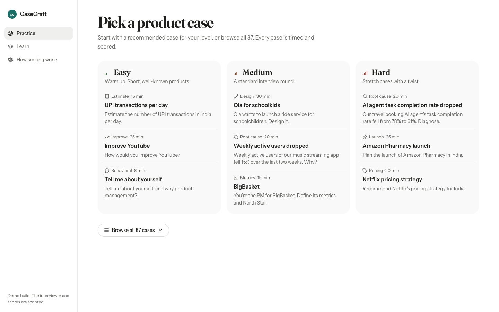
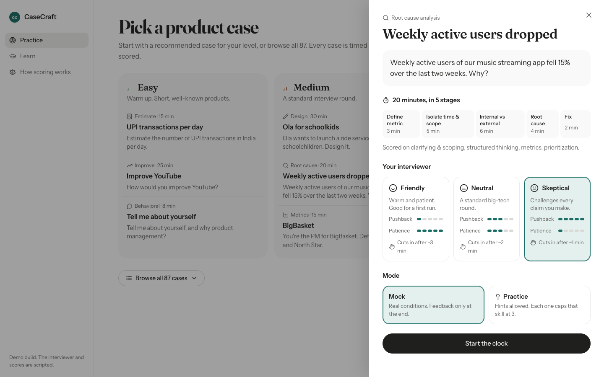
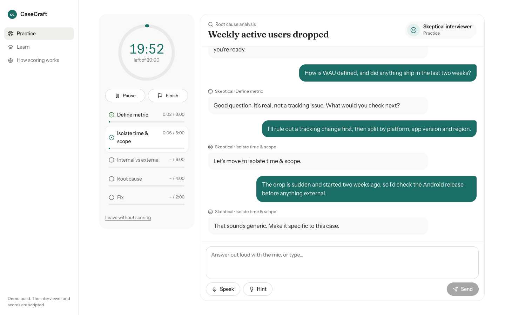
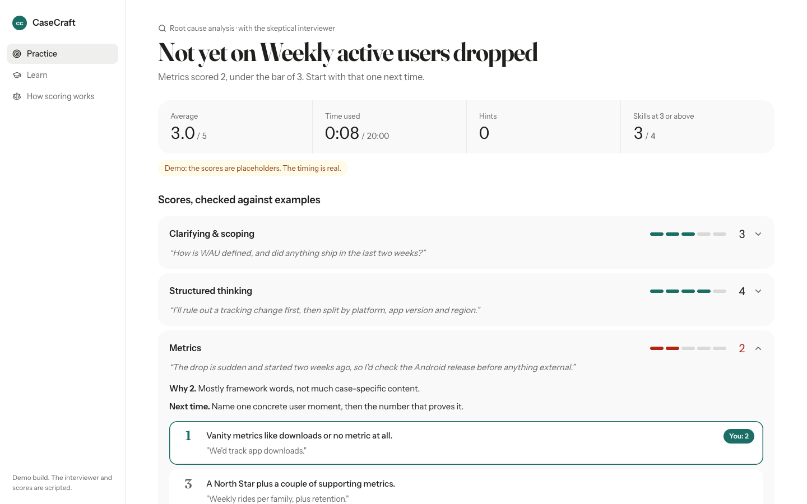
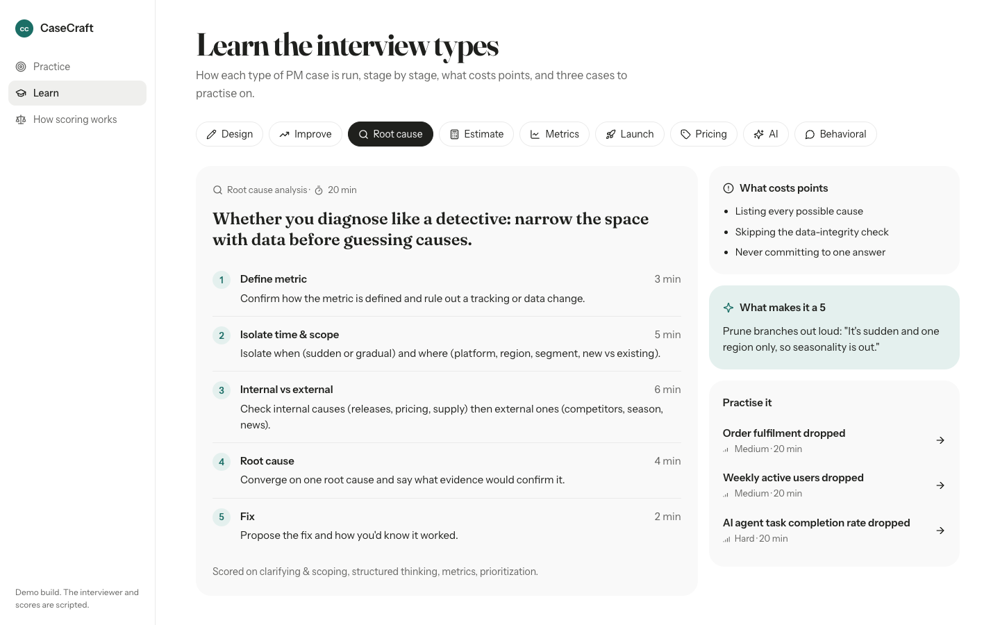

# CaseCraft

A practice room for product manager interviews: pick a case, face an interviewer, beat the clock, get scored.

**Live demo:** https://madhavsomanath.github.io/casecraft/

> **Status: front-end demo.** The clock, stage tracking, voice dictation, hints and timing report are real. The interviewer's replies and the scores are scripted placeholders. Nothing is sent to an AI model, and no API key is needed.



## What's in it

- **Practice:** three recommended cases each for Easy, Medium and Hard, plus all 87 cases across 9 interview types: product design, improvement, root cause analysis, estimation, metrics, launch and GTM, pricing, AI product and behavioral. Filter by type and difficulty, or search.
- **Setup:** pick an interviewer (friendly, neutral or skeptical), each shown with how much they push back, how patient they are and when they cut in. Pick a mode: mock (no help) or practice (hints allowed, each one caps that skill's score at 3).
- **Interview room:** a countdown clock for the whole case and a target time for each stage, which turns amber at 80% and red when over. Pause, jump between stages, and answer by typing or by voice (Chrome, Edge and Safari).
- **Report:** pass or not yet, a score per skill with a quote from your answer, the example answers that a 1, a 3 and a 5 look like, and your time against the target for each stage.
- **Learn:** for each interview type, what it tests, what to do in each timed stage, what costs points, what makes an answer a 5, and three cases to practise on.
- **How scoring works:** the scoring rules and the 1, 3 and 5 examples for all 11 skills.

| Choosing an interviewer | The interview room |
| --- | --- |
|  |  |

| The report | Learn |
| --- | --- |
|  |  |

## Run it locally

Needs Node 20 or later.

```bash
git clone https://github.com/MadhavSomanath/casecraft.git
cd casecraft
npm install
npm run dev
```

Then open the address Vite prints (usually http://localhost:5173).

## Project layout

- `src/data/cases.ts`: the 87 cases, with interviewer-only facts for the root cause and estimation cases
- `src/data/rubric.ts`: interview types, their stages and time budgets, the skills, and the 1/3/5 calibration examples
- `src/data/learn.ts`: the Learn content for each interview type
- `src/data/ui.ts`: icons and the three interviewer personalities
- `src/demo.ts`: the scripted interviewer and placeholder scores
- `src/components/`: Practice (`Library`), `Learn`, `Room`, `Report`, `Scoring`

## Roadmap

- **v1:** Claude as the live interviewer and scorer. You run it yourself with your own Anthropic API key, through a small local server so the key stays out of the browser. Fuller case content (facts to reveal, curveballs, model answers), calibration examples for each interview type, and sessions saved on your machine.
- **v2:** a progress dashboard across sessions.

## About

Built by [Madhav Somanath](https://github.com/MadhavSomanath) to practise PM case interviews.

## License

[MIT](LICENSE)
